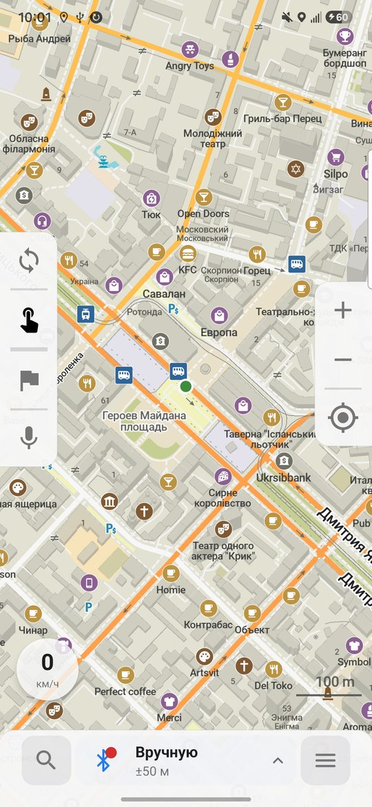
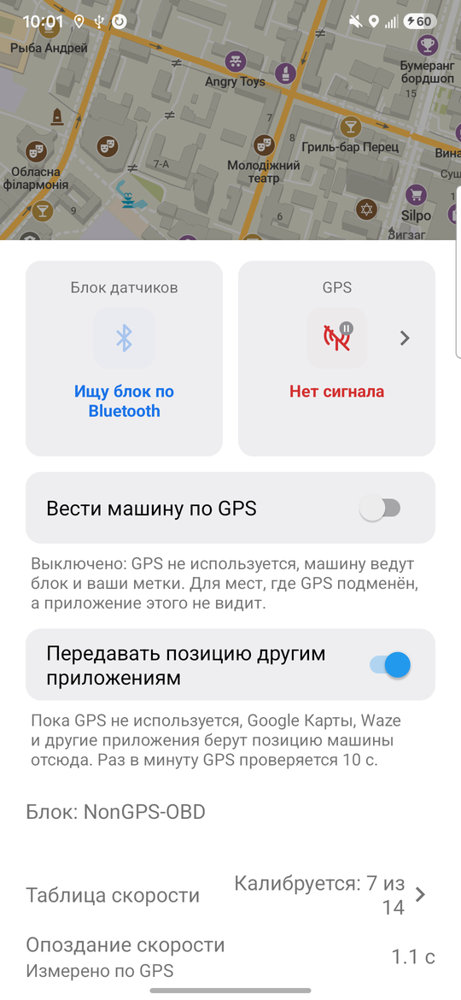
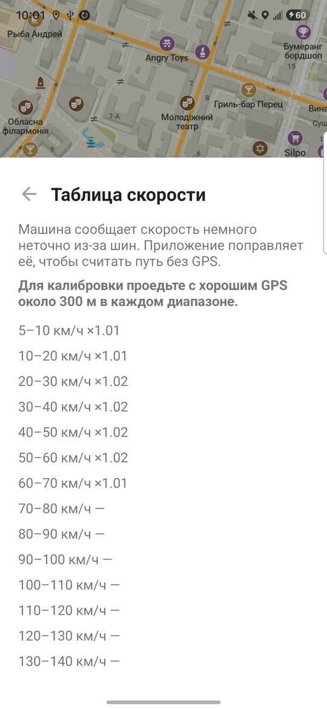

# NonGPS Maps

**Офлайн-навігація для водіїв, яка працює там, де GPS глушать або підміняють.**

NonGPS Maps — застосунок для Android та iOS на основі [Organic Maps](https://organicmaps.app) ([GitHub](https://github.com/organicmaps/organicmaps)).
Коли супутникова навігація зникає або показує машину в іншому місті, застосунок помічає це сам і веде
машину за даними **блоку датчиків**: маленький пристрій у роз'ємі OBD-II читає швидкість автомобіля, має
гіроскоп з акселерометром і передає поворот та швидкість телефону по Bluetooth LE. Телефон лише показує
карту, його можна тримати в руках. Без блоку застосунок працює як звичайні офлайн-карти, а в ручному режимі
позначку ставите ви.

> 🚧 **Статус: активна розробка (альфа).** Застосунок щодня тестується в реальних поїздках по Дніпру.
> Блок датчиків ще готується до продажу: передзамовлення та опис — на [non-gps.com](https://non-gps.com).
> Мета — стабільний випуск у Google Play.

*English summary: an Android and iOS fork of Organic Maps for driving under GPS jamming and spoofing. It
detects spoofed positions, switches to a manual mode and keeps the car on the roads with dead reckoning
from a small ESP32 sensor box in the OBD-II port (gyroscope, accelerometer, car speed), connected over
Bluetooth LE. The firmware of the box: [ELMandIMU](https://github.com/Ramzess-II/ELMandIMU).*

<p align="center">
  
  
  
</p>

---

## Що вміє

### 🛰️ Захист від глушіння та підміни GPS
- Позиція GPS звіряється з позицією за вишками та Wi-Fi і з тим, як далеко машина могла проїхати.
  Підмінений GPS ігнорується, а одиночна хибна позиція за мережею не вимикає справний GPS.
- Коли GPS зникає, підмінений або розходиться з рахунком, застосунок сам вмикає ручний режим.
- До GPS повертається автоматично, коли той знову надійний: без розривів і стрибків, збігається з позицією
  машини або їде разом з машиною дорогами з тією ж швидкістю.
- **Стан GPS** завжди видно: добрий, перевіряється, грубий (лише вежі й Wi-Fi), підмінений, немає.
- Перемикач **«Вести машину по GPS»**: для місць, де GPS підмінено, а застосунок цього не бачить, машину
  ведуть блок і ваші позначки.
- Між точками GPS (раз на секунду) позначка рухається плавно: її веде рахунок, а не стрибки раз на секунду.

### 🚗 Інерціальна навігація
- **Блок датчиків (ESP32, Bluetooth LE):** вставляється в роз'єм OBD-II і жорстко закріплений у машині.
  Читає швидкість автомобіля, а курс рахує сам за гіроскопом і акселерометром, тому телефон можна не
  закріплювати. Прошивка блоку — в окремому репозиторії [ELMandIMU](https://github.com/Ramzess-II/ELMandIMU),
  технічне завдання на неї і протокол: [`docs/nogps/esp32-firmware-spec.md`](docs/nogps/esp32-firmware-spec.md).
  Застосунок сам перепідключається до блоку, показує, коли блок спить, і оновлює його прошивку по Bluetooth.
  Акселерометр блоку відчуває розгін і гальмування раніше, ніж швидкість доходить з машини, а його напрямок
  у машині застосунок визначає сам.
- Машина тримається доріг і маршруту: позиція прив'язується до дороги, поворот переноситься на перехрестя,
  де він справді був (у тому числі на розвилках під кутом і кільцях), а плавний вигин дороги поворотом
  не вважається.
- Кілька можливих позицій одночасно: перевірка по дорозі обирає ту, що пасує, і не відкидає решту.
- Якщо розрахунок вивів машину з доріг, позначка зупиняється на дорозі й просить відмітитися.
- Фоновий режим на Android (окрема служба): зв'язок з блоком не обривається, поки застосунок згорнуто.
- **Позиція для інших застосунків (Android):** Google Maps, Waze та інші беруть позицію машини з NonGPS Maps,
  поки GPS не використовується. Вмикається в листі блоку.

### 🎯 Самокалібрування
- **Таблиця поправок швидкості:** похибку швидкості з OBD застосунок вимірює за надійним GPS окремо для
  кожного діапазону швидкостей (по 10 км/год). Таблиця вчиться постійно, зберігається між поїздками і
  показана на окремій сторінці. Для нових діапазонів застосовується груба поправка за вже виміряними.
- **Запізнення швидкості** (скільки секунд відстає швидкість від GPS) вимірюється й враховується.
- **Гіроскоп** обнуляється на кожній зупинці. Замір застосовується, лише якщо його підтверджує наступний,
  тож рушання з місця не псує калібрування. Якщо блок зрушили чи встановили іншим боком, напрямок акселерометра вчиться заново.

### ✋ Ручний режим
- Позначка ставиться дотиком до карти (кнопка з пальцем) або кнопкою «Я тут» у картці місця й лягає вздовж
  дороги. Напрямок береться з гіроскопа блоку або з двох позначок, кнопка розвертає машину.
- Пауза руху на час маневрів: паркування, розворот у кілька прийомів.
- Маршрут перебудовується від позначки в той бік, куди їде машина. Місце машини зберігається між запусками.

### 🧭 Для водія
- **Нижня панель:** пошук, широка кнопка джерела позиції (GPS, інерціально, вручну) з точністю `±N м` і
  кольором стану, меню. Тап відкриває лист блоку датчиків.
- **Кругла кнопка швидкості** внизу ліворуч: швидкість позиції, що веде позначку, і дорожній знак
  обмеження швидкості на дорозі (з OpenStreetMap). Понад обмеження число червоніє.
- **Навігація:** згорнутий лист із часом і відстанню до кінця та пройденою відстанню, права панель із
  категоріями поруч (пальне, парковка, їжа, продукти, банкомат).
- Голосові підказки з перемикачем на лівій панелі, екран не гасне під час руху.
- Попередження, якщо OBD-адаптер або блок перестав передавати швидкість.
- Тільки автомобільні маршрути.
- Посилання на місця з інших застосунків (Google Maps, Apple Maps) відкриваються в NonGPS Maps.
- **Журнал поїздки** за кожен день для розбору складних випадків (вмикається в налаштуваннях); його можна
  переглянути в браузері командою `just logs`. Для тестувальників при цьому з'являються кнопки-прапорці, якими
  позначають мить, коли машину показано не там, у тому числі голосовою нотаткою. Версія збірки й коміт видно в «Про застосунок».

Усе інше — офлайн-карти OpenStreetMap, пошук, маршрути, закладки — успадковано від Organic Maps.

---

## Обладнання

Блок датчиків — єдине, чим застосунок веде машину: Android та iOS працюють з ним однаково.

| Що | Примітки |
|---|---|
| Блок датчиків на ESP32 з гіроскопом, акселерометром і читанням швидкості з OBD-II | Вставляється в роз'єм OBD-II, з телефоном з'єднується по Bluetooth LE. Будь-яке авто з OBD-II. |
| Телефон з Android чи iOS | Закріплювати не потрібно |

---

## Збірка

Потрібні JDK 17, Android SDK та NDK (див. [docs/INSTALL.md](docs/INSTALL.md)).

```bash
git clone --recurse-submodules https://github.com/Ramzess-II/NoNGPS-Maps.git
cd NoNGPS-Maps/android
./gradlew assembleFdroidDebug -Parm64     # APK: app/build/outputs/apk/fdroid/debug/
```

Модульні тести навігації — у ядрі C++, разом із тестами Organic Maps:

```bash
cmake --preset debug -B build
cmake --build build --target map_tests
QT_QPA_PLATFORM=offscreen ./build/map_tests --filter=NoGps_
```

Часті команди зібрані в [`justfile`](justfile) для [just](https://github.com/casey/just); `just` показує їх
усі:

```bash
just android        # зібрати, встановити й запустити налагоджувальну збірку на підключеному телефоні
just apk            # лише зібрати APK
just test           # зібрати й запустити тести NoGps_ на комп'ютері (macOS, Linux)
just logs logs.zip  # переглянути поїздки з логів застосунку в браузері
just ios            # macOS: зібрати, встановити й запустити налагоджувальну збірку iOS на підключеному iPhone,
                    # без нього — на симуляторі; `just ios sim` — на симуляторі, `just ios "<назва>"` — на ньому
just appstore       # macOS: зібрати релізну збірку iOS з версією останнього коміту й надіслати в App Store Connect
```

iOS збирається з `xcode/omim.xcworkspace`, схема `OMaps` (див. [iphone/CLAUDE.md](iphone/CLAUDE.md)). 

Карти завантажуються в самому застосунку. Код навігації без GPS спільний для Android та iOS:
- [`libs/map/nogps`](libs/map/nogps) — детектор підміни, повернення до GPS, ручний режим, інерціальна
  навігація, калібрування, протокол блоку ESP32;
- [`libs/routing`](libs/routing), [`libs/map`](libs/map) — прив'язка до доріг і маршруту;
- [`android/sdk/.../location/`](android/sdk/src/main/java/app/organicmaps/sdk/location/) та
  [`iphone/Maps/Core/NoGps/`](iphone/Maps/Core/NoGps/) — те, що залежить від платформи: позиції, датчики,
  з'єднання з адаптером і блоком.

---

## Шлях до продакшну

- [x] Власна назва та іконка, тексти застосунку називають його NonGPS Maps.
- [x] Дозвіл команди Organic Maps на використання їхніх карт і серверів (див. нижче).
- [x] Екран «Про застосунок» у головному меню з посиланнями на Organic Maps і OpenStreetMap.
- [ ] Власна колірна схема замість зеленого кольору Organic Maps.
- [x] Адреса підтримки для звітів про помилки: most05062014@gmail.com.
- [x] [Політика конфіденційності](docs/nogps/privacy-policy.md), тексти й графіка для сторінки в магазині,
      [інструкція з публікації в Google Play](docs/nogps/google-play.md).
- [x] Релізна збірка: підпис ключем із `app/secure.properties`, нативні бібліотеки вирівняні під 16 КБ.
- [x] «Поділитися» надсилає посилання openstreetmap.org, нові скриншоти для магазину.
- [ ] Закритий тест у Google Play (12 тестувальників, 14 днів).
- [ ] Зовнішній блок датчиків ESP32: [прошивка](https://github.com/Ramzess-II/ELMandIMU) в роботі, корпус,
      кріплення.
- [ ] Перевірка в поїздках: кільця, розв'язки, розвилки, затори.
- [ ] Збір звітів про збої без персональних даних.

---

## Ліцензії

NonGPS Maps — похідна робота від Organic Maps і розповсюджується на тих самих умовах.

| Що | Ліцензія | Файл |
|---|---|---|
| Вихідний код Organic Maps і наші зміни | Apache License 2.0 | [LICENSE](LICENSE), [NOTICE](NOTICE) |
| Скомпільовані дані карт (`.mwm`, `.bin`) | Окрема ліцензія Organic Maps на основі ODbL | [DATA_LICENSE.txt](DATA_LICENSE.txt) |
| Дані OpenStreetMap | Open Database License (ODbL) 1.0 | [LICENSES/ODbL-1.0.txt](LICENSES/ODbL-1.0.txt) |
| Сторонні бібліотеки | MIT, BSD, Boost, zlib та інші | [LICENSES/](LICENSES), [3party/](3party), [data/copyright.html](data/copyright.html) |

**Обов'язкова атрибуція:** «Map data © OpenStreetMap and Organic Maps» з посиланнями на
https://www.openstreetmap.org/copyright і https://organicmaps.app — на карті, в меню та в розділі
«Про застосунок». У NonGPS Maps вона є в пункті головного меню «Про застосунок · Organic Maps».

**Дозвіл Organic Maps.** Ліцензія на дані карт забороняє ребрендинг без письмового дозволу. Команда
Organic Maps (жовтень 2026) дозволила NonGPS Maps використовувати їхні карти та сервери, поки
користувачів не більше тисячі, за умови атрибуції з назвою, на яку можна натиснути, і посиланням на
проєкт у місці, видимому всім користувачам. Для більшої кількості користувачів умови треба узгодити
з ними окремо.

Organic Maps — торгова марка Organic Maps Project. NonGPS Maps — незалежний проєкт і не пов'язаний з
командою Organic Maps та не підтримується нею.

---

## Безпека

Інерціальна навігація накопичує похибку, особливо без калібрування. Звіряйтеся з дорогою і знаками,
не відволікайтеся від керування. Позначку ставте, коли це безпечно, або доручіть пасажиру.

## Подяки

Команді та спільноті [Organic Maps](https://github.com/organicmaps/organicmaps), учасникам
[OpenStreetMap](https://www.openstreetmap.org) та авторам бібліотек, на яких побудовано проєкт.
